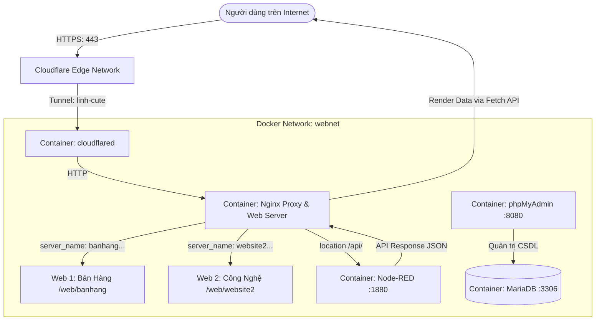

# BTVN PHÁT TRIỂN ỨNG DỤNG TRÊN NỀN WEB

> **Sinh viên thực hiện:** Nguyễn Phạm Đan Linh  
> **Lớp:** K59.KMT  
> **Trường:** Đại học Kỹ thuật Công nghiệp - Đại học Thái Nguyên (TNUT)  
> **Môn học:** Phát triển ứng dụng trên nền Web  
> **Domain:** `danlinhsiucutie.id.vn`  
> **Cloudflare Tunnel:** `linh-cute`  
> **Website 1 (Bán hàng):** `https://banhang.danlinhsiucutie.id.vn`  
> **Website 2 (Công nghệ):** `https://website2.danlinhsiucutie.id.vn`  
> **API Backend:** `https://banhang.danlinhsiucutie.id.vn/api/tacke`  

---

## 1. Giới thiệu & Mục tiêu dự án

Dự án này là bài tập thực hành toàn diện môn **Phát triển ứng dụng trên nền Web**, bao gồm 2 bài tập lớn theo yêu cầu của giảng viên:

- **Bài tập 1 — Triển khai Môi trường Web Container hóa:**
  1. Giả lập môi trường Linux OS (WSL2 Ubuntu).
  2. Cài đặt và cấu hình Docker & Docker Compose trên Linux.
  3. Triển khai đồng thời 5 dịch vụ cốt lõi: **Nginx**, **Node-RED**, **MariaDB**, **phpMyAdmin**, **Cloudflared**.
  4. Cấu hình Nginx Virtual Host chạy độc lập 2 website khác nhau với 2 subdomain:
     - `banhang.danlinhsiucutie.id.vn`
     - `website2.danlinhsiucutie.id.vn`
  5. Thiết lập Cloudflare Tunnel (`linh-cute`) kết nối bảo mật từ máy local ra Internet mà không cần mở port modem hoặc IP tĩnh.

- **Bài tập 2 — Xây dựng API bằng Node-RED & Tích hợp Frontend:**
  1. Tạo Flow Node-RED chuẩn theo chuỗi: `HTTP In` $\rightarrow$ `Function` $\rightarrow$ `HTTP Response`.
  2. Xây dựng thuật toán xử lý dữ liệu sinh viên và tính tổng số tiền (Function Node).
  3. Chuẩn hóa định dạng JSON trả về: `{"ok": 1, "msg": "thành công", "dssv": [...]}`.
  4. Cấu hình Nginx Reverse Proxy điều hướng `/api/` về Node-RED (tránh lỗi CORS).
  5. Viết mã JavaScript Fetch API trên giao diện HTML để gọi API, xử lý kết quả, hiển thị danh sách, tính tổng tiền và xử lý lỗi.

---

## 2. Kiến trúc Hệ thống



---

## 3. Cấu trúc Thư mục Dự án

```text
BTVN_PHAT-TRIEN-UNG-DUNG-TREN-NEN-WEB/
│
├── nginx/                          # Cấu hình Web Server Nginx
│   ├── nginx.conf                  # File cấu hình chính Nginx
│   └── conf.d/                     # Cấu hình Virtual Hosts
│       ├── website1.conf           # Vhost cho banhang.danlinhsiucutie.id.vn
│       └── website2.conf           # Vhost cho website2.danlinhsiucutie.id.vn
│
├── web/                            # Mã nguồn 2 Website
│   ├── banhang/                    # Website 1: Cửa hàng công nghệ & Dashboard API
│   │   ├── index.html              # Giao diện chính tích hợp Fetch API
│   │   ├── css/
│   │   │   └── style.css           # Giao diện hiện đại, responsive
│   │   ├── js/
│   │   │   └── main.js             # Logic Fetch API /api/tacke, tính tổng tiền
│   │   └── images/                 # Tài nguyên hình ảnh
│   │
│   └── website2/                   # Website 2: Trang công nghệ & giới thiệu hệ thống
│       ├── index.html              # Giao diện độc lập website 2
│       ├── css/
│       │   └── style.css
│       ├── js/
│       └── images/
│
├── nodered/                        # Cấu hình & Flow Node-RED
│   └── flows.json                  # Flow API /api/tacke (HTTP In -> Function -> Response)
│
├── mariadb/                        # Cơ sở dữ liệu MariaDB
│   └── init/
│       └── 01-init.sql             # Script khởi tạo database `shopdb`, bảng sinh viên và sản phẩm
│
├── .env.example                    # File mẫu biến môi trường (không lộ token/mật khẩu)
├── .gitignore                      # Loại bỏ file nhạy cảm và dữ liệu volume khỏi Git
├── docker-compose.yml              # Quản lý toàn bộ 5 dịch vụ Docker
└── README.md                       # Tài liệu hướng dẫn chi tiết
```

---

## 4. Hướng dẫn Môi trường Linux & Docker Compose (Bài tập 1)

### Bước 1: Kích hoạt WSL2 và cài đặt Ubuntu
Trên Windows PowerShell (Run as Administrator):
```powershell
wsl --install -d Ubuntu
```
Khởi động lại máy tính nếu được yêu cầu, sau đó mở Ubuntu từ Start Menu và thiết lập username/password.

Kiểm tra trạng thái:
```bash
wsl -l -v
```

### Bước 2: Cài đặt Docker Desktop & Tích hợp WSL2
1. Tải và cài đặt Docker Desktop cho Windows.
2. Mở Docker Desktop $\rightarrow$ **Settings** $\rightarrow$ **General** $\rightarrow$ tích chọn **Use the WSL 2 based engine**.
3. Vào **Settings** $\rightarrow$ **Resources** $\rightarrow$ **WSL Integration** $\rightarrow$ Bật công tắc kích hoạt cho bản phân phối **Ubuntu**.
4. Kiểm tra trong terminal Ubuntu hoặc PowerShell:
```bash
docker --version
docker compose version
```

### Bước 3: Cấu hình biến môi trường
Trước khi khởi chạy, tạo file `.env` từ `.env.example`:
```bash
cp .env.example .env
```
Mở file `.env` và điền `TUNNEL_TOKEN` từ Cloudflare Zero Trust của bạn:
```env
TUNNEL_TOKEN=eyJhIjoi...
MYSQL_ROOT_PASSWORD=mariadb_root_pass_2026
MYSQL_DATABASE=shopdb
MYSQL_USER=webuser
MYSQL_PASSWORD=webuser_pass_2026
```

### Bước 4: Khởi chạy 5 dịch vụ
Kiểm tra cú pháp cấu hình Docker Compose:
```bash
docker compose config
```

Khởi chạy ngầm toàn bộ 5 container:
```bash
docker compose up -d
```

Kiểm tra danh sách và trạng thái container:
```bash
docker compose ps
```

Xem log các dịch vụ khi cần kiểm tra:
```bash
docker compose logs -f nginx
docker compose logs -f cloudflared
docker compose logs -f nodered
```

---

## 5. Cấu hình Nginx 2 Website 2 Domain (Bài tập 1 - Yêu cầu 4)

Nginx được cấu hình 2 Virtual Host riêng biệt trong thư mục `nginx/conf.d/`:

1. **`website1.conf`**:
   - `server_name banhang.danlinhsiucutie.id.vn;`
   - Gốc dữ liệu: `/usr/share/nginx/html/banhang`
   - Reverse Proxy: Chuyển tiếp toàn bộ `location /api/` sang `http://nodered:1880/api/`
2. **`website2.conf`**:
   - `server_name website2.danlinhsiucutie.id.vn;`
   - Gốc dữ liệu: `/usr/share/nginx/html/website2`

Cả 2 website hoạt động hoàn toàn độc lập, giao diện khác nhau và không bị chồng chéo dữ liệu.

---

## 6. Cấu hình Cloudflare Tunnel `linh-cute` (Bài tập 1 - Yêu cầu 5)

Để người dùng trên Internet truy cập được 2 tên miền, thực hiện cấu hình trên [Cloudflare Zero Trust Dashboard](https://one.dash.cloudflare.com/):

1. Truy cập **Networks** $\rightarrow$ **Tunnels** $\rightarrow$ Chọn tunnel hiện có: **`linh-cute`**.
2. Chọn tab **Published application routes** (hoặc **Public Hostname**), nhấn **Add a public hostname** cho 2 domain:
   - **Route 1 (Website Bán Hàng):**
     - Subdomain: `banhang`
     - Domain: `danlinhsiucutie.id.vn`
     - Service Type: `HTTP`
     - URL: `nginx:80`
   - **Route 2 (Website 2):**
     - Subdomain: `website2`
     - Domain: `danlinhsiucutie.id.vn`
     - Service Type: `HTTP`
     - URL: `nginx:80`
3. Lưu cấu hình. Cloudflare Tunnel sẽ tự động tạo bản ghi CNAME và bảo vệ lưu lượng bằng chứng chỉ SSL/TLS miễn phí.

---

## 7. Xây dựng API Node-RED & JavaScript Fetch API (Bài tập 2)

### Flow Node-RED (`nodered/flows.json`)
Flow API được triển khai theo mô hình 3 khối:
$$\text{HTTP In (GET /api/tacke)} \longrightarrow \text{Function Node} \longrightarrow \text{HTTP Response (JSON)}$$

#### Thuật toán trong Function Node:
Thuật toán quản lý sinh viên và tính tổng số tiền đóng quỹ:
1. **Khởi tạo danh sách:** Mảng đối tượng sinh viên gồm họ tên (`name`) và số tiền (`money`).
2. **Tính tổng số tiền:** Sử dụng phương thức `Array.prototype.reduce()` để tính tổng tích lũy tất cả giá trị `money`.
3. **Thống kê số lượng:** Đếm tổng số lượng bản ghi bằng `dssv.length`.
4. **Tìm người đóng góp cao nhất:** Duyệt qua danh sách để tìm bản ghi có `money` lớn nhất.
5. **Định dạng trả về:** Chuẩn hóa đầu ra đúng cấu trúc giảng viên yêu cầu (`ok`, `msg`, `dssv`), kèm khối thống kê `summary`.

```javascript
// Function Node code tóm tắt:
const dssv = [
    { name: "Đan Linh", money: 123 },
    { name: "David", money: 456 },
    { name: "Thầy Cốp", money: 789 },
    { name: "Minh Anh", money: 250 },
    { name: "Văn Hoàng", money: 320 }
];

const totalMoney = dssv.reduce((sum, sv) => sum + sv.money, 0);
const totalStudents = dssv.length;

msg.payload = {
    ok: 1,
    msg: "thành công",
    dssv: dssv,
    summary: {
        total_students: totalStudents,
        total_money: totalMoney
    }
};
return msg;
```

### JSON Trả về từ API (`GET /api/tacke`):
```json
{
  "ok": 1,
  "msg": "thành công",
  "dssv": [
    { "name": "Đan Linh", "money": 123 },
    { "name": "David", "money": 456 },
    { "name": "Thầy Cốp", "money": 789 },
    { "name": "Minh Anh", "money": 250 },
    { "name": "Văn Hoàng", "money": 320 }
  ],
  "summary": {
    "total_students": 5,
    "total_money": 1938
  }
}
```

### JavaScript Fetch API trong Website (`web/banhang/js/main.js`)
Website gọi API qua relative path `/api/tacke` để Nginx tự động reverse proxy tới Node-RED:
- Sử dụng `fetch('/api/tacke')`.
- Kiểm tra mã trạng thái `response.ok` và kiểm tra giá trị `data.ok === 1`.
- Duyệt mảng `data.dssv`, render bảng HTML động, tính tổng tiền và số lượng.
- Có nút **"Tải lại dữ liệu"** để cập nhật thời gian thực.
- Có cơ chế bắt lỗi `try...catch` và thông báo lỗi rõ ràng nếu API mất kết nối.

---

## 8. Bảng Nghiệm thu Yêu cầu (Checklist)

| Mục kiểm tra | Trạng thái | Ghi chú |
| :--- | :---: | :--- |
| **Linux OS / WSL2 Ubuntu** | Hoàn thành | Ubuntu 2.0 trên WSL2 |
| **Docker & Docker Compose** | Hoàn thành | Docker Compose v2 cấu hình chuẩn |
| **5 Dịch vụ Docker** | Hoàn thành | Nginx, Node-RED, MariaDB, phpMyAdmin, Cloudflared |
| **Virtual Host 2 Website** | Hoàn thành | `banhang` & `website2` cấu hình độc lập |
| **Cloudflare Tunnel `linh-cute`** | Sẵn sàng | Đã cấu hình container, chỉ cần add hostname trên Dash |
| **API Node-RED (`/api/tacke`)** | Hoàn thành | Flow chuẩn HTTP In $\rightarrow$ Function $\rightarrow$ HTTP Response |
| **JSON theo mẫu đề bài** | Hoàn thành | Đúng chuẩn `{"ok":1, "msg":"...", "dssv":[...]}` |
| **JavaScript Fetch API** | Hoàn thành | Gọi API, render bảng, tính tổng tiền, xử lý lỗi |
| **Bảo mật Git & Token** | Hoàn thành | Đã thêm `.gitignore` và `.env.example`, không push token |

---

## 9. Thao tác Git & Đưa lên GitHub

```bash
# Kiểm tra trạng thái Git
git status

# Thêm tất cả các file đã chuẩn hóa
git add .

# Tạo commit dự án
git commit -m "Hoan thien toan bo bai tap 1 va bai tap 2 mon PTUD tren nen Web"

# Đẩy code lên nhánh main của repository
git push -u origin main
```
