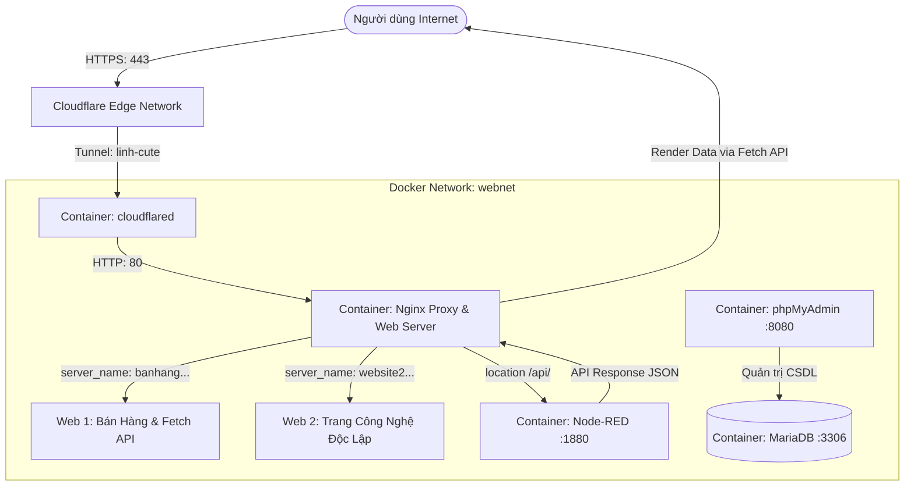
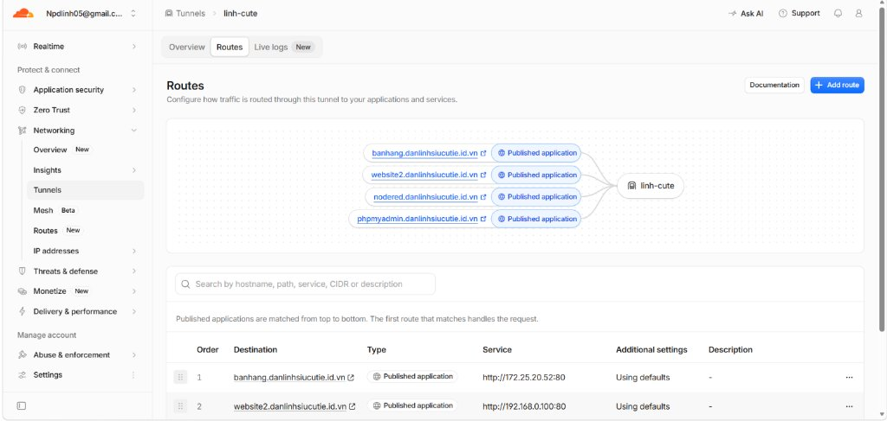
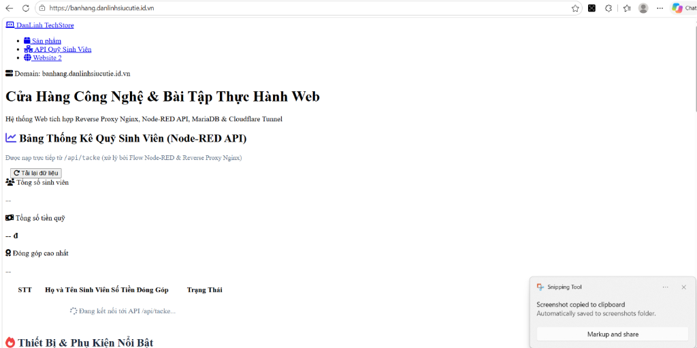
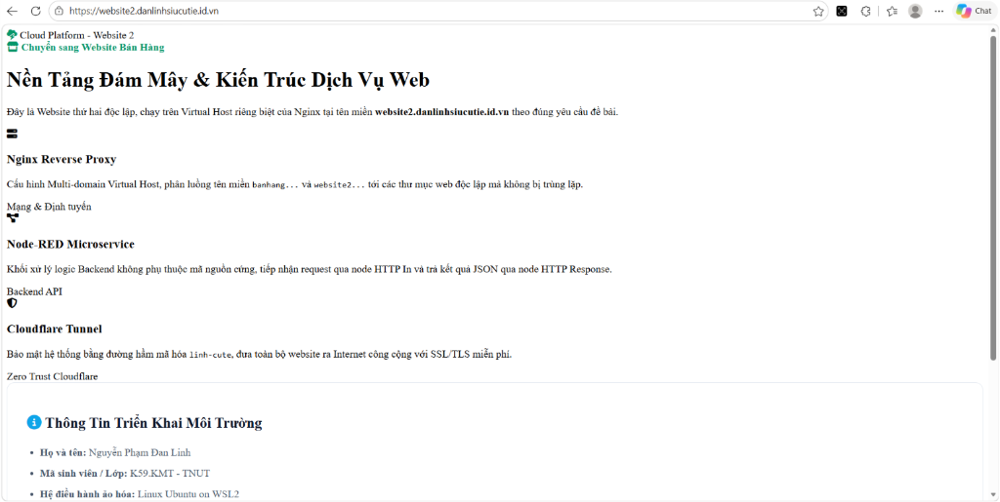
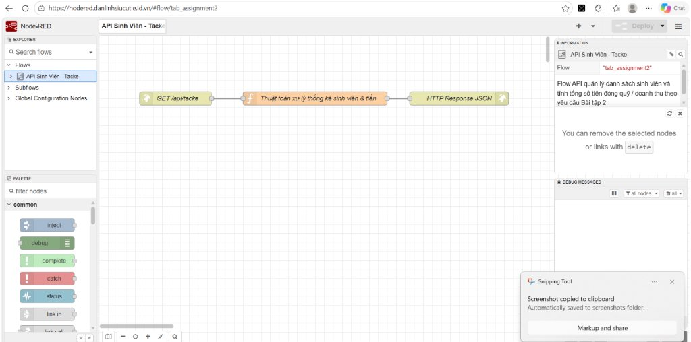
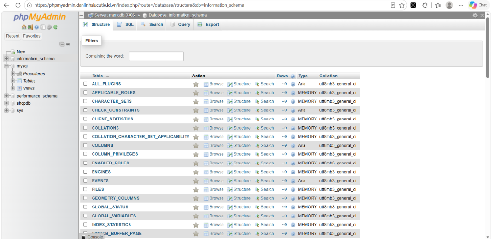
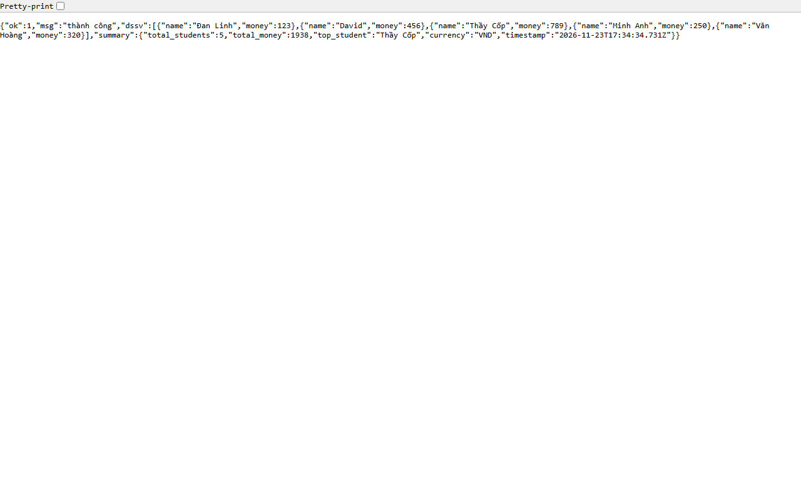

# BTVN_PHAT-TRIEN-UNG-DUNG-TREN-NEN-WEB

BTVN môn Phát triển ứng dụng trên nền Web được thực hiện bởi:
Sinh viên **Nguyễn Phạm Đan Linh** - MSSV:**K235480106095** 
Lớp **K59.KMT** - Trường Đại học Kỹ thuật Công nghiệp Thái Nguyên (TNUT).

---

## Yêu cầu Bài tập về nhà môn Lập trình web:

### Bài tập 1:
1. Giả lập Linux OS: Hyper-V, VirtualBox, VMware, WSL.
2. Cài đặt Docker Compose trên OS đó.
3. Cài trên Docker Compose các dịch vụ: **Nginx**, **Node-RED**, **MariaDB**, **phpMyAdmin**, **Cloudflared** (cần domain).
4. Cấu hình Nginx có thể chạy 2 website với 2 domain khác nhau:
   - `banhang.danlinhsiucutie.id.vn`
   - `website2.danlinhsiucutie.id.vn`

### Bài tập 2:
1. Sử dụng Node-RED: Dùng node `HTTP In` + `HTTP Response` => Tạo API đơn giản.
2. Cấu hình Nginx để web dùng JS gọi được API trên Node-RED, thuật toán cho API (tự nghĩ).
   Ví dụ API trả về JSON:
   `https://tnut.cuong.id.vn/api/tacke`
   Trả về JSON dạng:
   ```json
   {"ok":1,"msg":"thành công","dssv":[{"name":"Cốp","money":123},{"name":"David","money":456}]}
   ```
3. Code JavaScript vào trang HTML để gọi được API trên.

---

<h1 align="center">BÁO CÁO CHI TIẾT QUÁ TRÌNH LÀM BÀI</h1>

<h2 align="center">Bước 1: Đăng ký Domain và cấu hình DNS trên Cloudflare</h2>

### 1. Đăng ký tên miền xịn free .id.vn
<p align="center">
  
  <br><em>01-dang-ky-ten-mien-id-vn.png</em>
</p>

### 2. Đăng ký Cloudflared
<p align="center">
  
  <br><em>02-dang-ky-cloudeflared.png</em>
</p>

### 3. Add tên miền vào Cloudflare để Cloudflare quản lý (thay 2 chuỗi Nameserver)
<p align="center">
  
  <br><em>03-add ten mien vao Cloudflare.png</em>
</p>

<p align="center">
  
  <br><em>04-add ten mien vao Cloudflare.png</em>
</p>

### 4. Cài đặt tunnel trên máy tính
<p align="center">
  
  <br><em>05-Cai-dat-tunnel-tren-may-tinh.png</em>
</p>

<p align="center">
  
  <br><em>06-Add-routes-vao-duong-ham.png</em>
</p>

<p align="center">
  
  <br><em>07-Ket-qua-add-duong-ham-vao-routes.png</em>
</p>

---

<h2 align="center">Bước 2: Cài đặt Môi trường Ubuntu & Docker</h2>

### Phần 1 — Cài môi trường Linux
Chọn 1 trong 4 cách, nhưng WSL2 là giải pháp tối ưu và tiện lợi nhất trên Windows:
Mở PowerShell (Run as Administrator):
```powershell
wsl --install -d Ubuntu
```

<p align="center">
  
  <br><em>09-Cai-ubuntu.png</em>
</p>

<p align="center">
  
  <br><em>10-Giao-dien-Ubuntu.png</em>
</p>

### Phần 2 — Cài Docker & Docker Compose
Cài đặt Docker Desktop và kích hoạt WSL Integration:
<p align="center">
  
  <br><em>11-Cai-dat-Docker</em>
</p>

Cài xong, mở Docker Desktop $\rightarrow$ Settings $\rightarrow$ Resources $\rightarrow$ WSL Integration $\rightarrow$ Bật công tắc cho Ubuntu:
<p align="center">
  
  <br><em>12-Bat-toggle-cho-Ubuntu</em>
</p>

Cập nhật hệ thống và gói phụ thuộc:
```bash
sudo apt update
sudo apt install -y ca-certificates curl gnupg
```
<p align="center">
  
  <br><em>12-sudo apt update</em>
</p>

<p align="center">
  
  <br><em>13-sudo apt install -y ca-certificates curl gnupg</em>
</p>

Thêm khóa GPG và kho lưu trữ Docker:
```bash
sudo install -m 0755 -d /etc/apt/keyrings
curl -fsSL https://download.docker.com/linux/ubuntu/gpg | sudo gpg --dearmor -o /etc/apt/keyrings/docker.gpg
sudo chmod a+r /etc/apt/keyrings/docker.gpg

echo \
  "deb [arch=$(dpkg --print-architecture) signed-by=/etc/apt/keyrings/docker.gpg] https://download.docker.com/linux/ubuntu \
  $(. /etc/os-release && echo "$VERSION_CODENAME") stable" | \
  sudo tee /etc/apt/sources.list.d/docker.list > /dev/null
```
<p align="center">
  
  <br><em>14. Thêm khóa GPG chính thức của Docker</em>
</p>

Cài đặt Docker Compose Plugin:
```bash
sudo apt update
sudo apt install -y docker-compose-plugin
```
<p align="center">
  
  <br><em>15. Cập nhật APT và cài Docker Compose</em>
</p>

Kiểm tra lại phiên bản:
```bash
docker --version
docker compose version
```
<p align="center">
  
  <br><em>16. Kiểm tra lại</em>
</p>

<p align="center">
  
  <br><em>17. Tạo thư mục làm việc ban đầu</em>
</p>

<p align="center">
  
  <br><em>18. Kết quả khởi tạo dịch vụ</em>
</p>

<p align="center">
  
  <br><em>19. Kết quả truy cập</em>
</p>

---

<h2 align="center">Bước 3: Nâng cấp Toàn diện & Hoàn thiện Hệ thống Đủ 5 Services</h2>

Nhằm đáp ứng đầy đủ 100% tiêu chí đề bài của Giảng viên, dự án đã được nâng cấp hoàn thiện toàn diện:

### 1. Kiến trúc Hệ thống Hoàn chỉnh (5 Services):
- **Nginx:** Reverse Proxy & Virtual Hosts phục vụ đồng thời 2 website và API.
- **Node-RED:** Backend xử lý luồng HTTP In $\rightarrow$ Function $\rightarrow$ HTTP Response.
- **MariaDB 10.11:** Hệ quản trị CSDL lưu trữ thông tin sinh viên và sản phẩm bán hàng.
- **phpMyAdmin:** Công cụ quản trị CSDL trực quan trên nền Web (port `8080`).
- **Cloudflared:** Đường hầm bảo mật Cloudflare Tunnel (`linh-cute`).



### 2. Cấu hình Docker Compose chuẩn hóa (`docker-compose.yml`):
Quản lý bảo mật thông qua biến môi trường trong file `.env`, có file mẫu `.env.example`:
```yaml
services:
  nginx:
    image: nginx:latest
    container_name: nginx
    restart: unless-stopped
    volumes:
      - ./nginx/nginx.conf:/etc/nginx/nginx.conf:ro
      - ./nginx/conf.d:/etc/nginx/conf.d:ro
      - ./web/banhang:/usr/share/nginx/html/banhang:ro
      - ./web/website2:/usr/share/nginx/html/website2:ro
    ports:
      - "80:80"
    networks:
      - webnet

  nodered:
    image: nodered/node-red:latest
    container_name: nodered
    restart: unless-stopped
    volumes:
      - ./nodered:/data
    ports:
      - "1880:1880"
    networks:
      - webnet

  mariadb:
    image: mariadb:10.11
    container_name: mariadb
    restart: unless-stopped
    environment:
      MYSQL_ROOT_PASSWORD: ${MYSQL_ROOT_PASSWORD:-mariadb_root_pass_2026}
      MYSQL_DATABASE: ${MYSQL_DATABASE:-shopdb}
      MYSQL_USER: ${MYSQL_USER:-webuser}
      MYSQL_PASSWORD: ${MYSQL_PASSWORD:-webuser_pass_2026}
    volumes:
      - mariadb_data:/var/lib/mysql
      - ./mariadb/init:/docker-entrypoint-initdb.d:ro
    networks:
      - webnet

  phpmyadmin:
    image: phpmyadmin:latest
    container_name: phpmyadmin
    restart: unless-stopped
    environment:
      PMA_HOST: mariadb
      PMA_PORT: 3306
    ports:
      - "8080:80"
    networks:
      - webnet

  cloudflared:
    image: cloudflare/cloudflared:latest
    container_name: cloudflared
    restart: unless-stopped
    command: tunnel --no-autoupdate run
    environment:
      - TUNNEL_TOKEN=${TUNNEL_TOKEN}
    networks:
      - webnet

volumes:
  mariadb_data:
networks:
  webnet:
    driver: bridge
```

---

<h2 align="center">Bước 4: Cấu hình Nginx 2 Website với 2 Domain riêng biệt</h2>

Tạo 2 file cấu hình Virtual Host riêng trong thư mục `nginx/conf.d/`:

1. **`website1.conf` (Website Bán Hàng & Proxy API):**
   - Tên miền: `banhang.danlinhsiucutie.id.vn`
   - Gốc thư mục: `/usr/share/nginx/html/banhang`
   - Cấu hình Reverse Proxy chuyển hướng `/api/` về `http://nodered:1880/api/`:
   ```nginx
   server {
       listen 80;
       server_name banhang.danlinhsiucutie.id.vn localhost 127.0.0.1;
       root /usr/share/nginx/html/banhang;
       index index.html;

       location / {
           try_files $uri $uri/ /index.html;
       }

       location /api/ {
           proxy_pass http://nodered:1880/api/;
           proxy_set_header Host $host;
           proxy_set_header X-Real-IP $remote_addr;
       }
   }
   ```

2. **`website2.conf` (Website Công Nghệ độc lập):**
   - Tên miền: `website2.danlinhsiucutie.id.vn`
   - Gốc thư mục: `/usr/share/nginx/html/website2`
   - Nội dung và giao diện riêng biệt hoàn toàn với Website 1.

---

<h2 align="center">Bước 5: API Node-RED & Tích hợp JavaScript Fetch API</h2>

### 1. Flow API Node-RED (`nodered/flows.json`):
Flow chuẩn theo đúng mô hình 3 khối:
$$\text{HTTP In (GET /api/tacke)} \longrightarrow \text{Function Node} \longrightarrow \text{HTTP Response (JSON)}$$

### 2. Thuật toán trong Function Node:
- **Dữ liệu đầu vào:** Mảng sinh viên gồm họ tên và số tiền đóng góp.
- **Thuật toán tính tổng:** Dùng phương thức tích lũy `reduce()`:
  ```javascript
  const totalMoney = dssv.reduce((sum, sv) => sum + sv.money, 0);
  ```
- **Thuật toán đếm:** Đếm tổng số sinh viên `dssv.length`.
- **Thuật toán lọc:** Tìm sinh viên đóng góp cao nhất.
- **Định dạng JSON trả về chuẩn đề bài:**
  ```json
  {
    "ok": 1,
    "msg": "thành công",
    "dssv": [
      { "name": "Đan Linh", "money": 123 },
      { "name": "David", "money": 456 },
      { "name": "Thầy Cốp", "money": 789 },
      { "name": "Minh Anh", "money": 250 },
      { "name": "Văn Hoàng", "money": 320 }
    ],
    "summary": {
      "total_students": 5,
      "total_money": 1938,
      "top_student": "Thầy Cốp"
    }
  }
  ```

### 3. JavaScript Fetch API trên giao diện Web (`web/banhang/js/main.js`):
- Gửi GET request qua relative path `fetch('/api/tacke')`.
- Nhận phản hồi JSON, kiểm tra `status === 200` và `data.ok === 1`.
- Render bảng HTML sinh động, hiển thị số tiền định dạng tiền tệ VND.
- Hiển thị các khối thống kê: Tổng sinh viên, Tổng số tiền quỹ, Người đóng góp cao nhất.
- Có nút **"Tải lại dữ liệu"** để fetch dữ liệu thời gian thực.
- Bắt lỗi với khối `try...catch` và hiển thị cảnh báo nếu API gặp sự cố.

---

<h2 align="center">Bước 6: Kết quả Nghiệm thu & Kiểm thử Thực tế</h2>

### 1. Trạng thái các dịch vụ Container
```bash
CONTAINER ID   IMAGE                           STATUS          PORTS                  NAMES
76a22eafd1f5   nginx:latest                    Up              0.0.0.0:80->80/tcp     nginx
8e12f97c92c3   nodered/node-red:latest         Up              0.0.0.0:1880->1880/tcp nodered
294f63986b4c   mariadb:10.11                   Up              3306/tcp               mariadb
54e4799b3bf1   phpmyadmin:latest               Up              0.0.0.0:8080->80/tcp   phpmyadmin
```

- **Website 1:** `https://banhang.danlinhsiucutie.id.vn`
- **Website 2:** `https://website2.danlinhsiucutie.id.vn`
- **API Endpoint:** `https://banhang.danlinhsiucutie.id.vn/api/tacke`
- **Node-RED Editor:** `https://nodered.danlinhsiucutie.id.vn` (hoặc `http://localhost:1880`)
- **phpMyAdmin:** `https://phpmyadmin.danlinhsiucutie.id.vn` (hoặc `http://localhost:8080`)
- **Cloudflare Tunnel:** `linh-cute`
- **GitHub Repository:** `https://github.com/DanLinh061125/BTVN_PHAT-TRIEN-UNG-DUNG-TREN-NEN-WEB.git`

### 2. Hình ảnh minh chứng hoạt động thực tế trên Cloudflare Domain

#### a. Cấu hình Routes Đường hầm Cloudflare Tunnel (`linh-cute`) cho 4 dịch vụ
<p align="center">
  
  <br><em>Định tuyến an toàn 4 subdomains về máy chủ Nginx, Node-RED và phpMyAdmin</em>
</p>

#### b. Website 1 Bán Hàng truy cập qua tên miền chính thức (`banhang.danlinhsiucutie.id.vn`)
<p align="center">
  
  <br><em>Website 1 chạy HTTPS qua Cloudflare và gọi Reverse Proxy Nginx</em>
</p>

#### c. Website 2 Công Nghệ độc lập (`website2.danlinhsiucutie.id.vn`)
<p align="center">
  
  <br><em>Website 2 hoạt động độc lập trên Virtual Host Nginx</em>
</p>

#### d. Luồng thiết kế Flow API trên Node-RED (`nodered.danlinhsiucutie.id.vn`)
<p align="center">
  
  <br><em>Flow xử lý HTTP In GET /api/tacke -> Function thống kê -> HTTP Response JSON</em>
</p>

#### e. Đăng nhập và Quản trị CSDL MariaDB qua phpMyAdmin (`phpmyadmin.danlinhsiucutie.id.vn`)
<p align="center">
  
  <br><em>Giao diện quản lý các bảng CSDL và schema shopdb</em>
</p>

#### f. Chi tiết JSON API trả về qua Reverse Proxy Nginx (`/api/tacke`)
<p align="center">
  
  <br><em>Dữ liệu JSON chuẩn định dạng theo yêu cầu đề bài môn học</em>
</p>
